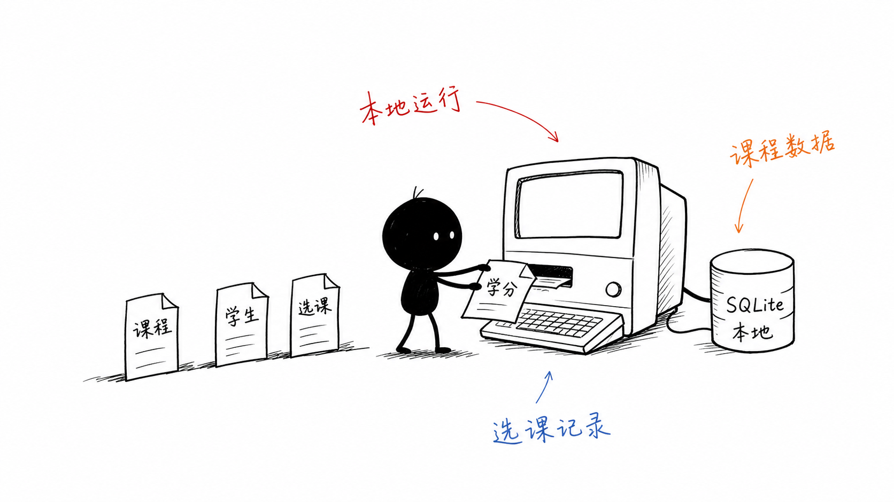
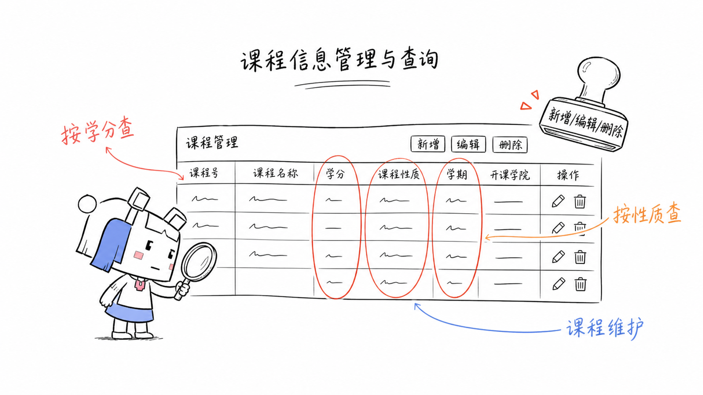
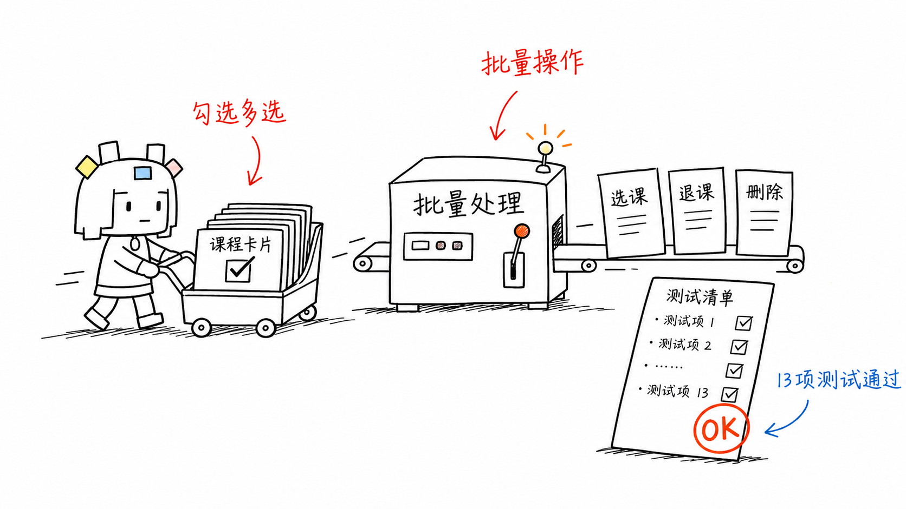

# 🎓 学生选修课程系统

[](https://www.python.org/)
[](https://docs.python.org/3/library/tkinter.html)
[](https://www.sqlite.org/)
[](./LICENSE)

一个基于 Python + Tkinter + SQLite 构建的学生选修课程管理系统，具备角色权限控制、密码安全哈希、像素风动效 UI 和完整的单元测试。

> 💡 本项目为学生选修课程管理系统，内置带有趣味命名的示例课程，便于首次运行后直接体验。

---

## ✨ 功能特性

### 🔐 身份认证
- **双角色登录**：管理员 `admin` / 学生 `student`
- **PBKDF2-SHA256 密码哈希**：12 万次迭代 + 随机 16 字节盐，数据库零明文
- **时序安全校验**：使用 `hmac.compare_digest` 防时序攻击

### 👑 管理员功能
- 📚 课程 CRUD（课程代码、类型、学时、学分、学期）
- 👨‍🎓 学生信息管理
- ✅ 选课/退课审批
- 📊 毕业学分达标检查
- 📤 课程表 / 选课表 CSV 导出

### 🧑‍🎓 学生功能
- 📖 浏览可选课程
- 🖊️ 一键选课 / 退课
- 📈 查看已修学分与毕业要求差距
- 🔒 只能看到和操作自己的数据

### 🎨 界面亮点
- 🌈 **NyanCat 登录页**：星空 + 彩虹尾迹 + 循环飞行
- 🐱 **侧边栏看板娘**：跟随鼠标轻微转向（需 Pillow）
- 💥 **点击烟花粒子**：每次点击触发像素风烟花
- 🎮 **像素风主题**：复古配色 + Consolas 等宽字体

### 🧪 工程化
- ✅ 完整单元测试（独立临时数据库，无污染）
- 📦 首次运行自动建表 + 种子数据
- 🗂️ 上下文管理器安全管理数据库连接
- 🔗 外键级联删除 + 唯一约束防重复选课

---

## 📸 系统截图

### 系统总览


### 角色登录


### 课程管理（管理员）


### 选课与学分检查


### 批量测试


---

## 🛠️ 技术栈

| 组件 | 技术 |
|------|------|
| 语言 | Python 3.10+ |
| GUI 框架 | Tkinter（标准库） |
| 数据库 | SQLite 3 |
| 图片处理 | Pillow（可选，用于看板娘转向） |
| 密码哈希 | hashlib PBKDF2-SHA256 |
| 测试框架 | unittest（标准库） |

---

## 🚀 快速开始

### 环境要求

- Python 3.10 或更高版本
- Windows / macOS / Linux（Tkinter 跨平台）

### 安装与运行

```bash
# 1. 克隆仓库
git clone https://github.com/Wynphor/student_course_system.git
cd student_course_system

# 2. 创建虚拟环境（推荐）
python -m venv .venv

# Windows PowerShell
.\.venv\Scripts\Activate.ps1

# macOS / Linux
source .venv/bin/activate

# 3. 安装依赖
pip install -r student_course_system/requirements.txt

# 4. 运行系统
python -m student_course_system.main
```

### 默认账号

系统首次启动时自动生成种子数据，内置以下账号：

| 角色 | 用户名 | 密码 |
|------|--------|------|
| 👑 管理员 | `admin` | `123456` |
| 🧑‍🎓 学生 | `1001` | `1001` |
| 🧑‍🎓 学生 | `1002` | `1002` |
| 🧑‍🎓 学生 | `1003` | `1003` |

> 💾 数据库文件位于 `student_course_system/data/elective_system.db`，删除该文件可重置全部数据。

---

## 🧪 运行测试

```bash
cd student_course_system
python -m unittest tests -v
```

测试覆盖：数据库初始化、课程 CRUD、学生 CRUD、选课/退课逻辑、毕业学分计算、用户认证等核心流程。

---

## 📁 项目结构

```
student_course_system/          ← 仓库根
├── student_course_system/      ← Python 包
│   ├── __init__.py
│   ├── main.py                 # 程序入口
│   ├── db.py                   # 数据库连接 + 建表 + 种子数据
│   ├── auth_utils.py           # PBKDF2 密码哈希
│   ├── services.py             # 业务层（Service 类）
│   ├── ui.py                   # Tkinter 主界面 + 动效组件
│   ├── pixel_assets.py         # 像素素材管理
│   ├── tests.py                # 单元测试
│   ├── requirements.txt        # 依赖清单
│   ├── assets/                 # 看板娘 / NyanCat 素材
│   └── data/                   # 运行时数据库（.gitignore）
├── ppt/                        ← 项目演示 PPT
│   ├── index.html
│   └── images/                 # PPT 配图
├── screenshots/                ← README 用的截图
├── README.md
├── LICENSE                     # MIT License
└── .gitignore
```

### 模块职责

| 模块 | 职责 |
|------|------|
| `main.py` | 入口：初始化数据库 → 创建主窗口 → 启动事件循环 |
| `db.py` | 封装 SQLite 连接（上下文管理器）、建表 DDL、种子数据 |
| `auth_utils.py` | `hash_password()` / `verify_password()`，PBKDF2-SHA256 |
| `services.py` | 业务逻辑层：`CourseService`、`StudentService`、`EnrollmentService`、`AuthService`、`SettingsService` |
| `ui.py` | 整个 GUI：登录页、主页、侧边栏、像素动画组件 |
| `tests.py` | 基于 `unittest` 的集成测试，每个用例使用独立临时数据库 |

---

## 📜 开源协议

本项目基于 [MIT License](./LICENSE) 开源。

```
THE SOFTWARE IS PROVIDED "AS IS", WITHOUT WARRANTY OF ANY KIND...
```

简单来说：随便用、随便改、随便分发，但请保留版权声明。

---

## 🙏 致谢

- Python 标准库 —— 一个 Tkinter 就能做出带动效的 GUI
- NyanCat —— 登录页的灵魂
- 看板娘素材 —— 让侧边栏不再孤单
